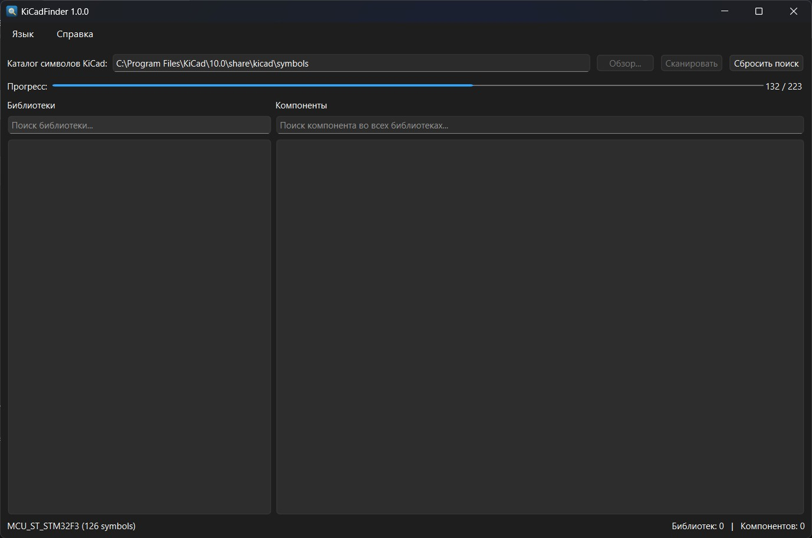
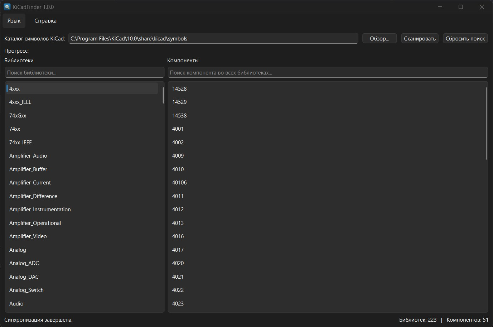
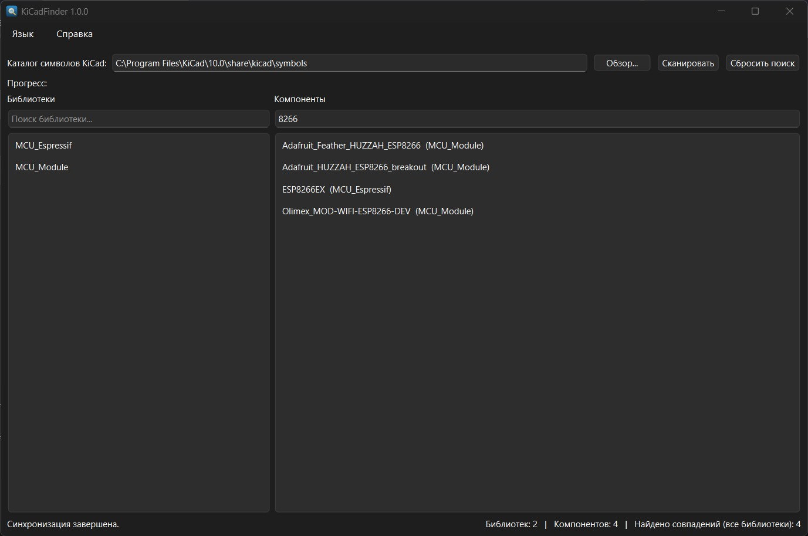

[🇷🇺 Русский](#russian) &nbsp;|&nbsp; [🇬🇧 English](#english)

---

## 🇷🇺 KiCadFinder — быстрый поиск компонентов для KiCad

**KiCadFinder** — это лёгкая и быстрая программа для поиска электронных компонентов по библиотекам символов KiCad. Она индексирует все файлы `*.kicad_sym` в локальную базу данных и позволяет мгновенно находить нужные компоненты, не открывая сам KiCad.

Встроенный поиск в KiCad работает только внутри редактора схем, а KiCadFinder запускается отдельно и ищет **сразу по всем библиотекам**. В левой панели отображаются библиотеки, в правой — компоненты. При вводе запроса список библиотек автоматически сужается до тех, где есть совпадения, что делает поиск максимально удобным.

Программа поддерживает русский и английский языки, запоминает путь к каталогу символов и работает в фоновом режиме, не блокируя интерфейс.

### Возможности

- 🔍 Глобальный поиск компонентов по всем библиотекам одновременно
- 📚 Автоматическое сужение списка библиотек по результатам поиска
- ⚡ Мгновенная индексация в SQLite, инкрементальное обновление
- 🌐 Два языка интерфейса: русский и английский
- 💾 Запоминание пути к библиотекам KiCad
- 🖥️ Работа в фоновом потоке — интерфейс никогда не зависает

### Скриншоты

*Поиск компонентов по всем библиотекам*

*Сужение списка библиотек и отображение совпадений*

*Подробная информация о сборке*

---

## 🇬🇧 KiCadFinder — fast component search for KiCad

**KiCadFinder** is a lightweight and fast tool for searching electronic components across KiCad symbol libraries. It indexes all `*.kicad_sym` files into a local database and lets you instantly find the components you need — without opening KiCad itself.

The built-in KiCad symbol chooser only works inside the schematic editor, while KiCadFinder runs as a separate application and searches **across all libraries at once**. The left pane lists libraries, the right pane shows components. As you type a query, the library list narrows down to those containing matches, making the search experience as smooth as possible.

The app supports English and Russian, remembers your symbols directory, and runs scanning in a background thread so the UI never freezes.

### Features

- 🔍 Global component search across all libraries at once
- 📚 Library list automatically narrows down to search results
- ⚡ Instant SQLite indexing with incremental updates
- 🌐 Two UI languages: English and Russian
- 💾 Remembers your KiCad libraries path
- 🖥️ Background scanning — the UI never freezes

### Screenshots

*Searching components across all libraries*

*Narrowed library list and matching components*

*Detailed build information*

---

### ❤️ Поддержать / Support

Если программа оказалась полезной, вы можете поддержать автора:

